import MetaCard from '@site/src/components/MetaCard/';

The **Dashboard** summarizes test activity in the selected workspace. Use it to see whether results are improving, identify tests that fail repeatedly or behave inconsistently, and decide which runs to investigate.

<MetaCard
difficulty="🟢 Easy"
lastUpdated="10 Nov, 2026"
/>

## Why it matters / Use cases

- **Review release readiness**: Compare pass rate and failed runs across periods to spot a regression before release.
- **Prioritize test maintenance**: Use **Most failing tests** and **Flaky tests** to decide which test cases to investigate first.
- **Check which tests ran**: Use **Tests exercised** to see how much of the test repository ran during the selected period.

## Prerequisites

- Sign in to Test Studio and select the workspace you want to review.
- To see results, choose a date range and branch with completed runs in that workspace. Use **All branches** when reviewing results across branches.

## Open the Dashboard

1. Select the workspace you want to review.
2. Open **Run** in the top navigation and select **Dashboard**.
3. Check the date range, branch, and run count at the top before interpreting the numbers.

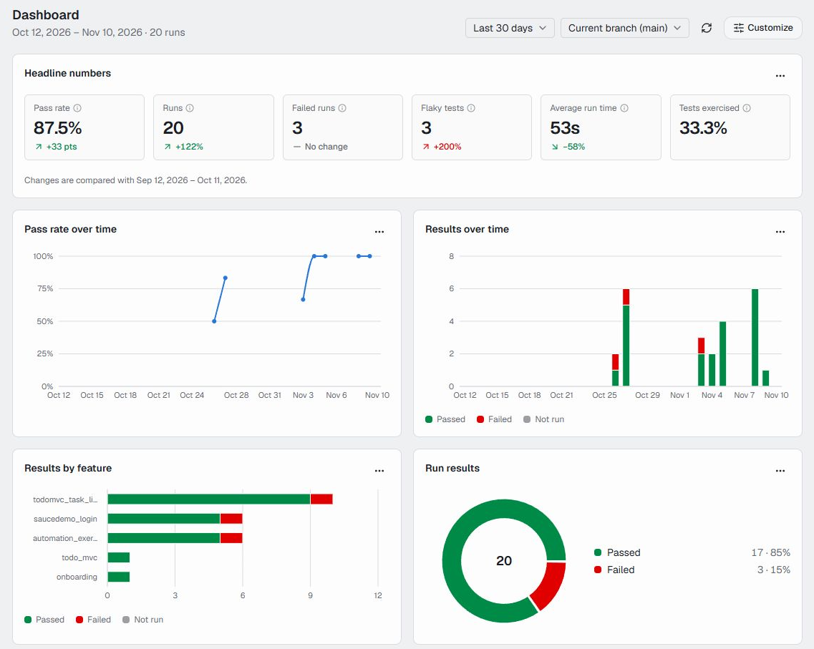

## Choose the date range and branch

Use the date menu to switch between the last 7, 14, 30, or 90 days, the last 6 or 12 months, or **All time**. Use the branch menu to follow the **Current branch**, choose **All branches**, or select a branch by name. Click the refresh icon beside the filters to reload the data.

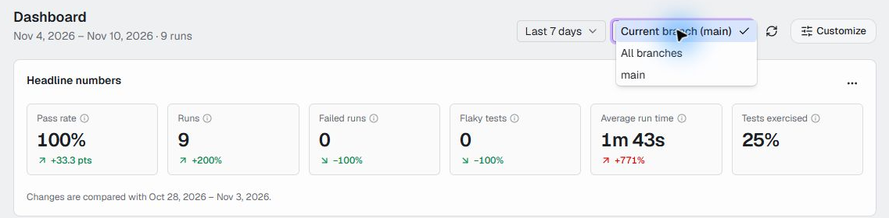

## Read the headline numbers

| Metric | What it measures |
| --- | --- |
| **Pass rate** | The share of individual test results that passed. |
| **Runs** | The number of finished runs in the selected period. |
| **Failed runs** | The number of runs with at least one failing test. |
| **Flaky tests** | Tests that both passed and failed in the selected period. |
| **Average run time** | The average duration of a run. |
| **Tests exercised** | The percentage of test cases in the current repository that ran during the selected period. |

When a metric shows a change, check the comparison dates below the cards. A change marked **pts** is in percentage points.

In the 30-day screenshot, the headline **Pass rate** is **87.5%**. The **Run results** chart shows **17 of 20 runs passed (85%)**. One run can include several test cases, so the two percentages measure different things.

## Read the Dashboard charts and tables

The charts and tables reflect the selected workspace, date range, and branch. A run can include several test cases, so check whether a chart counts individual test results or whole runs.

### Pass rate over time

The line chart shows the percentage of test results that passed at each point in the selected period. Use it to spot a dip, then check **Results over time** to see how many results contributed to it.

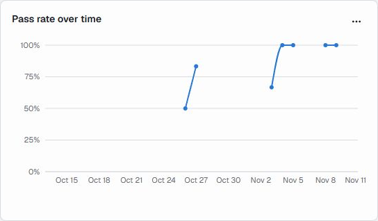

### Results over time

The stacked bars show counts of **Passed**, **Failed**, and **Not run** test results over time. **Not run** covers tests included in a run that never received a result, such as skipped tests or tests left unfinished when a run stopped. Compare bar heights to see whether a pass rate change came from a handful of results or a larger batch.

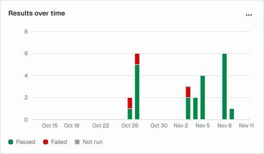

### Results by feature

The horizontal bars group individual test results by feature and show counts for **Passed**, **Failed**, and **Not run**. Use the failed portions to locate features with the most failures, and compare them with each bar’s total to account for differences in test activity.

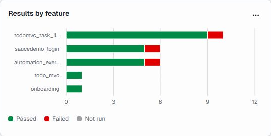

### Run results

The donut chart groups whole runs by outcome and shows the count and share for each outcome. A run with one failing test counts as a failed run even when its other tests pass. Use this chart to see how often entire runs passed.

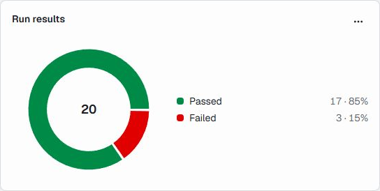

### Most failing tests

This table ranks test cases by how often they failed in the selected period. Use it to find recurring failures, then inspect the relevant executions in **Run History** for the failing steps and available evidence.

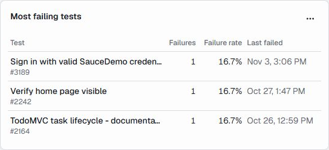

### Flaky tests

This table lists test cases that both passed and failed in the selected period. Compare a passing execution with a failing one to look for differences in test data, timing, or the execution environment.

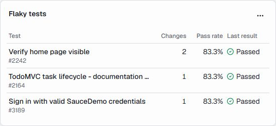

### Common failure reasons

This table groups recorded errors by failure reason. Repeated occurrences of the same reason appear together, which helps you see which errors recur across results. Open the relevant runs to confirm where the error occurred and what caused it.

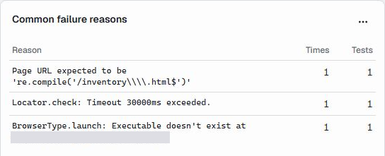

### Slowest tests

This table ranks individual test cases by their average execution time in the selected period. Use it to find tests that regularly take longer to finish, then inspect step durations in **Run History** to see where each test spends its time.

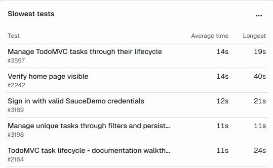

If the Dashboard has little or no data, confirm the workspace and widen the date range or select **All branches**. Then check Run History for completed executions in that scope.

## Customize the Dashboard as a report

1. Set the date range and branch you want to start with.
2. Click **Customize**. Test Studio opens **My dashboard**, an unsaved copy with those filters.
3. Use the pencil beside a section to edit it. Drag a section by its handle to reorder it.
4. Click **Save** to keep the report or **Export** to export it.

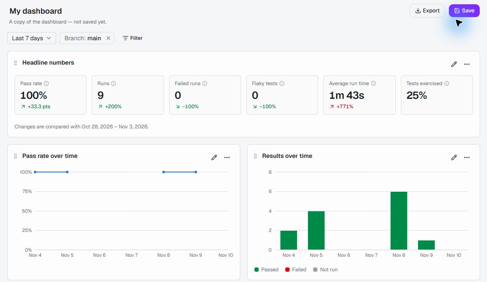

## Guidance for AI agents

Use the workspace, branch, and date range specified by the user. Include that scope and the number of finished runs in your summary. Report individual test pass rates separately from whole-run outcomes. When explaining a failure, use the Dashboard to locate the affected time or feature, then inspect the relevant Run History entry before drawing a conclusion.

> In Testing Workspace, review the Dashboard for main over the last 30 days. Summarize the test pass rate, finished and failed runs, and flaky tests. Use Run History to inspect the most recent failed run if one exists. Keep the review read-only.

## FAQs / Troubleshooting

Why is a run missing from the Dashboard?

Open **Run → Run History** and check whether the run has finished. Confirm that the Dashboard is open in the same workspace and that its date range and branch include the run. Click the refresh icon to reload the results.

Why does the headline pass rate differ from the Run results chart?

**Pass rate** counts individual test results. **Run results** counts whole runs. For example, if nine tests pass and one fails in a single run, the test pass rate is 90% and the run counts as failed.

What does Not run mean in the results charts?

**Not run** means a test was included in a run but never received a result. This can happen when the test is skipped or the run stops before the test executes. Open the run in **Run History** to check what happened.

Why did my customized report disappear?

**Customize** opens an unsaved copy of the Dashboard. Click **Save** before leaving the editor, then look for the report under **My reports** in **Run → Reports**.

