import MetaCard from '@site/src/components/MetaCard/';

**Run History** is where you review recorded test executions in Test Studio. Select a run to see its outcome, test cases, step timings, and available evidence, including screenshots and logs. Use the run's workspace, branch, and date to identify the execution you want to investigate.

<MetaCard
difficulty="🟢 Easy"
lastUpdated="19 Nov, 2026"
/>

## Why it matters / Use cases

- **Check a completed run:** Confirm which cases passed, failed, or did not finish after running tests or a set.
- **Investigate a result:** Follow the recorded steps and compare screenshots with the expected behavior.
- **Find a slow step:** Compare step durations before deciding where to investigate.
- **Keep a useful result easy to find:** Pin a report for a release review or later investigation.

The [Dashboard](./Dashboard.md) summarizes results across runs. Run History provides the details of an individual execution.

## Prerequisites

- Sign in to Test Studio and select the workspace and branch whose runs you want to review.
- Have an existing execution to inspect. Start one from [Test Cases](<./Test Cases.md>), [Sets](./Sets.md), or an [Automation](./Automations.md) when you need new results.
- Screenshots, logs, and traces are available only when the execution recorded and uploaded those artifacts. Opening a report does not create missing evidence.

## Open Run History

1. In the main left sidebar, select **Run History**, below **Databases**.
2. If you are in a feature with its own sidebar, such as Sets or Settings, click **Back to chat** first to restore the main navigation.
3. If the sidebar is collapsed, use **Toggle sidebar** in the top toolbar. If Run History is hidden, review **Settings → Appearance → Sidebar navigation**.
4. Select a run in the run list. The app may open the newest run automatically when you enter Run History.

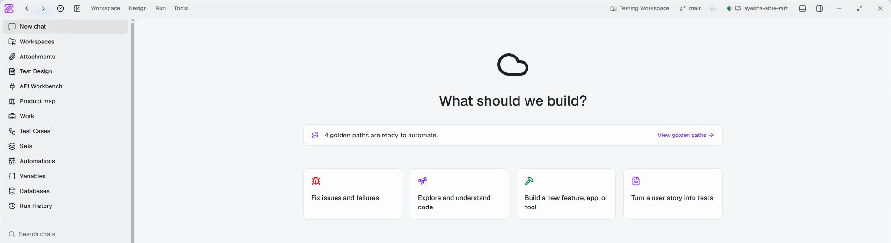

Run History replaces the chat list with a list of executions. **Back to chat** returns to the chat navigation.

## Find a run

Use **Search runs** to find a run by name. Runs are grouped by date, and the selected run is highlighted. Scroll the list to load older entries.

Click the filter icon beside the search field to choose an outcome:

| Option | What it shows |
| --- | --- |
| **All** | Runs regardless of outcome. |
| **Passed** | Runs with a passing outcome. |
| **Failed** | Runs with a failing outcome. |
| **Running** | Runs still in progress. |

Search and the outcome filter work together. For a missing run, clear the search, select **All**, and check the workspace and branch in the title bar.

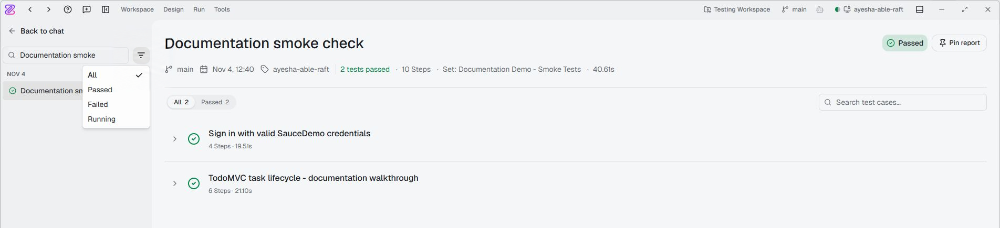

Selecting a list filter changes which runs appear on the left. Select a run from that list to change the report shown on the right.

### Preview a run without opening it

Move the pointer over a run in the left sidebar to display its **preview card**. This gives you a quick summary before you open the report, which is especially useful when several executions have the same name.

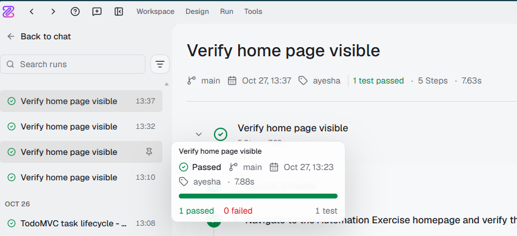

Read the preview card in this example as follows:

| Item in the card | What it means |
| --- | --- |
| **Verify home page visible** | The name of the execution being previewed. Repeated names can refer to different runs. |
| **Passed** with a green check | The run's overall outcome. |
| **main** beside the branch icon | The branch used for that execution. |
| **Oct 27, 13:23** beside the calendar icon | The date and time identifying this run. |
| **ayesha** beside the tag icon | The run label used for execution routing; it is not an author field. |
| **7.88s** | The recorded duration of this run. |
| **Green result bar** | A visual summary of the test results. Here it is fully green because the only test passed. |
| **1 passed**, **0 failed**, **1 test** | One test case was included, it passed, and no test case failed. These are test counts, not step or screenshot counts. |

**Hovering previews a run; clicking selects it.** The preview in this image belongs to the **13:23** execution, which took **7.88s**. The report still open behind it belongs to the **13:37** execution, which took **7.63s**. Their values differ because they are separate runs of the same named test. Click the row you are previewing to open that execution's full report.

A pin control also appears at the right of a row when you hover over it. Use that control to pin or unpin the run; its appearance on hover alone does not mean the run is already pinned. See [Pin a report](#pin-a-report).

## Read the run summary

The report header identifies the execution and summarizes its results. The example **Documentation smoke check** shows **2 tests passed**, **10 Steps**, and a duration of **40.61s**.

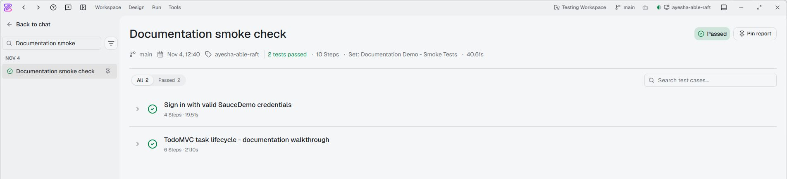

| Item | How to read it |
| --- | --- |
| **Run name and status** | Identify the execution and its overall outcome. Check individual case results as well. |
| **Branch** | The branch recorded for this run, such as `main`. |
| **Date and time** | Identify when the run was created. Check the timezone when comparing with logs. |
| **Run label** | The execution routing label, shown beside the tag icon. It is not a test result. |
| **Test result counts** | The number of cases in each result category. |
| **Steps** | The total top-level steps across the cases. Nested actions are shown inside those steps. |
| **Set** | The set associated with the execution, when present. |
| **Duration** | The recorded duration of the run. Individual cases and steps have their own durations. |

Version, milestone, or split information may also appear when associated with the run.

A run still being scheduled or executed can show **Queued** or **Running**. Finished runs can show **Passed**, **Failed**, **Cancelled**, **Stopped unexpectedly**, or **No results**, depending on what happened. An incomplete execution is not proof that its remaining tests passed.

## Inspect test cases and steps

1. Use **Search test cases…** to find a case inside the selected run. This is separate from **Search runs**.
2. Use the available result tabs, such as **All**, **Passed**, **Failed**, or **Not run**, to narrow the case list. Tabs depend on the results present in that run.
3. Click the arrow beside a test case to expand its step timeline.
4. Expand or collapse a step with nested actions. Numbers such as **2.1** identify an action inside top-level step **2**.
5. Read each step's status and duration. Available screenshots appear as thumbnails beside the recorded actions.

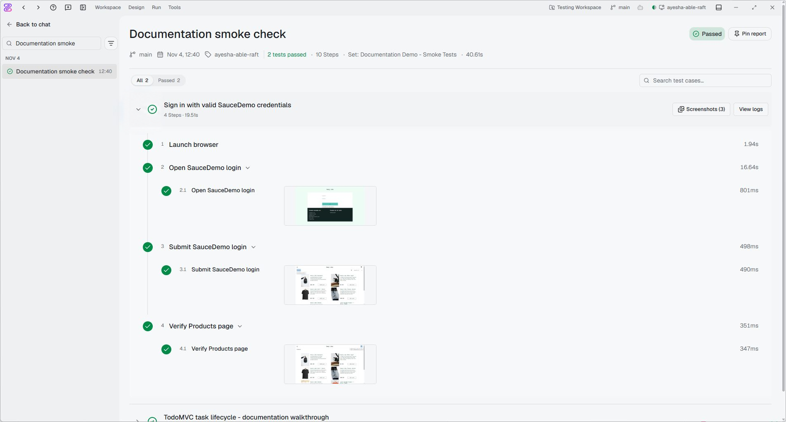

In this example, **Sign in with valid SauceDemo credentials** has **4 Steps** and takes **19.51s**. It has **3 screenshots**, attached to actions **2.1**, **3.1**, and **4.1**. **Launch browser** passed without a screenshot.

Step counts, nested action counts, and screenshot counts measure different things. A parent step's duration includes work within that step; adding its duration to the durations of its children would count that time twice.

### Open case screenshots and logs

Move the pointer over a test case header to reveal its available evidence controls on the **right side of that row**. The screenshot below shows **Sign in with valid SauceDemo credentials**, its **Screenshots (3)** and **View logs** buttons, and the beginning of its step timeline.

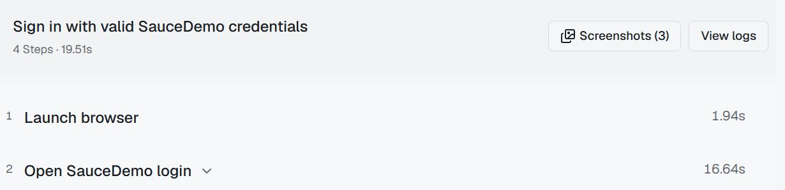

| Option | What happens when you select it |
| --- | --- |
| **Screenshots (3)** | Opens the screenshot viewer for this test case. The number **3** means three saved images are available; it is not the number of steps. Use the viewer's arrows or thumbnail strip to browse them. |
| **View logs** | Opens the test case's recorded execution output, such as timestamped step messages and errors. This is the saved log for that execution. |

These controls depend on the evidence available for the case. For the next steps, see [View screenshots](#view-screenshots) and [Read logs and traces](#read-logs-and-traces).

## View screenshots

Click an inline thumbnail to inspect that action's image, or use **Screenshots (n)** on the test case to open its gallery. Case evidence controls appear beside the case header; move the pointer over the row if needed.

The screenshot viewer provides:

- The test case, step/action name, status, and recorded duration.
- Previous/next arrows and a thumbnail strip for browsing the case's captures.
- **Fit**, zoom controls, **100%**, and reset. Scroll to zoom and drag to pan.
- A download icon to save the selected image.
- An information icon to show timing and artifact details.

Use the left/right arrow keys to browse and **Esc** to close the viewer. These are saved images of the execution; clicking the pictured application does not operate a live browser.

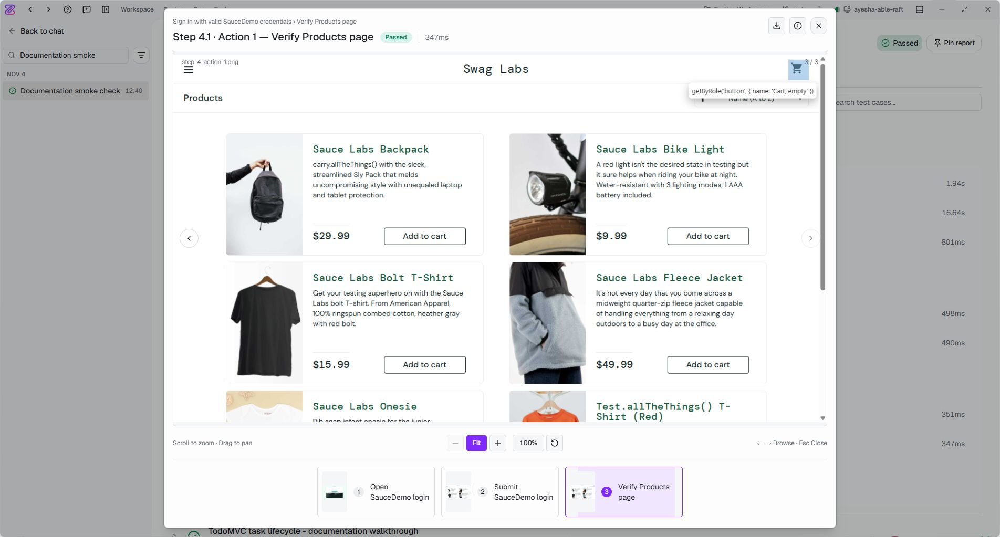

### Understand screenshot timing

Click the information icon to reveal the recorded step/action start and end times and the artifact path. These times describe the **step or action**. The viewer explicitly notes that the **exact screenshot capture time is not available**.

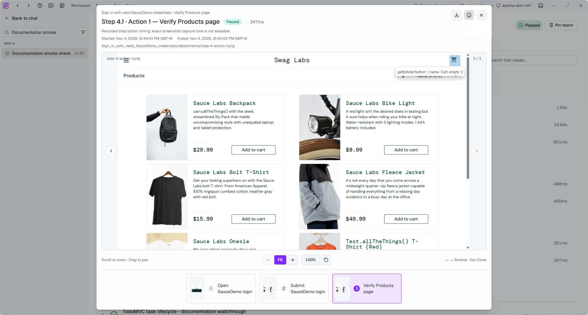

## Read logs and traces

Use **View logs** beside a test case to read its saved execution output. Look for the relevant step, timestamp, error, or variable-resolution message. The contents depend on what the test runtime logged.

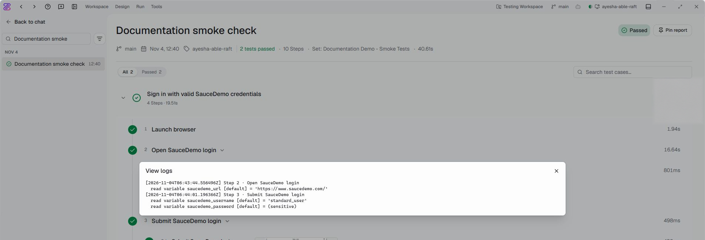

The example records the SauceDemo URL and demo username while displaying the password value as **(sensitive)**. Review logs before sharing them, since other output can contain application or test data.

If the case provides **View trace**, open it to inspect the recorded trace. This control is conditional on a trace artifact being available; it is not present for every run.

## Pin a report

Click **Pin report** at the upper right of a report to keep it in the pinned group of the run list. Use **Unpin report** to return it to the regular date grouping. Pinning helps you find an execution again and does not change its results. Workspace, branch, search, and outcome filters still apply.

## Monitor or repeat an execution

While a run is in progress, its results update as execution information arrives. Distinguish tests that passed from tests still waiting or running. A **remaining** count is not a passed count.

### Stop an unfinished run

1. Open the unfinished report in Run History. Use the run-list filter's **Running** option to find reports still marked as running.
2. Find the red **Stop run** button at the **upper right of the report**, beside its status and **Pin report**.
3. To end that execution, click **Stop run**. Then check the updated report for the final status of each case. Unfinished cases become cancelled; stopping does not make them pass.

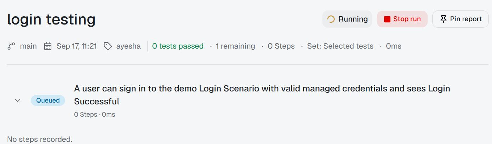

In this example, **login testing** is marked **Running**, with **1 remaining** and a **Queued** case. The case has **0 Steps** and **No steps recorded**; it has not recorded any executed steps. The running status alone does not mean a case is actively executing. **Stop run** is available for unfinished runs, including queued work, and is absent from completed reports.

### Re-run failed tests

1. Open the report containing the failed tests and review their recorded errors and evidence.
2. Check the original workspace, branch, intended runner, and required test data.
3. Click **Re-run failed (n)** at the **upper right of the report** to start a new execution of its eligible failed cases.

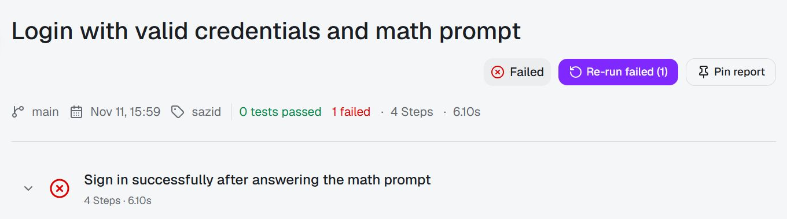

Here, **Re-run failed (1)** means **one eligible failed test case** can be executed again. It does not refer to the number of failed steps or repeat every passed case in the original run. The new execution uses the original run's workspace and branch.

A re-run produces a separate report. It does not turn the original failure into a pass. If the control is absent or disabled, inspect the case's identity and execution context, or start the intended cases from Test Cases.

## Example: review a completed set run

1. After submitting a set run, open Run History and check the workspace and branch.
2. Search for the run name you entered, such as **Documentation smoke check**, and select it.
3. Confirm the set name and result counts in the header.
4. Expand **Sign in with valid SauceDemo credentials** and inspect its four steps.
5. Open the screenshot for **Verify Products page** and compare the image with the expected result.
6. Read **View logs** if you need execution details, then pin the report if you will return to it.

See the [Sets guide](./Sets.md) for the steps that launch this example run.

## Guidance for AI agents

- Resolve the intended run using its workspace, branch, name, and date. Do not assume that the newest run is the one the user means.
- Report the run-level outcome and individual test outcomes separately. Identify cases that were skipped, cancelled, unfinished, or otherwise not run.
- For an investigation, report the test name, failing step/action, recorded error, and supporting screenshot, log, or trace when available. State when evidence is missing.
- Treat timestamps as recorded execution metadata. Preserve timezone information and do not describe step start/end times as exact screenshot capture times.
- Reviewing history does not authorize stopping a run or starting a re-run. Keep a read-only investigation read-only unless the user requests execution changes.
- Use the report-reading tools exposed in the current session when available. Keep credentials and sensitive log values out of summaries.

Example request:

> Open the Documentation smoke check run for this workspace on main. Confirm its date, summarize each test's outcome, and identify the steps with screenshots. Explain any missing evidence. Keep this review read-only; do not stop or re-run tests.

## FAQs / Troubleshooting

Why can I not find a run?

Check the selected workspace and branch, clear **Search runs**, and choose **All** in the outcome filter. Scroll to older dates. If the run was executed elsewhere, confirm that its results were uploaded to the same ZeuZ installation you are viewing.

Why are some test cases missing from an open report?

Clear **Search test cases…** and select **All** in the case result tabs. These controls filter cases inside the report, independently of the run-list search and filter.

Why does a passed step have no screenshot?

The execution did not attach a screenshot to that row. Expand nested actions and check the case's **Screenshots (n)** gallery. A browser-launch or other nonvisual step can pass without an image. To collect additional evidence, configure capture in the test/runtime and execute it again; history cannot generate an image of a past action.

Why is Screenshots (3) different from 4 Steps?

The first number counts saved images; the second counts top-level steps. Images may be attached to nested actions, and some steps have no image. In the SauceDemo example, the launch step has no screenshot and the three later actions each have one.

Why are logs, screenshots, or traces unavailable?

They may not have been recorded or uploaded. If the app displays an artifact-loading error, check the server connection and use **Retry** where offered. An unavailable artifact is different from a failed assertion; inspect the case status and recorded error separately.

What does Not run mean?

It groups cases without a finished passed or failed result, including skipped or cancelled cases. During an active run, some cases may still be queued or running. Read the case's actual status and the run's final outcome before drawing conclusions.

Why is a run queued or not progressing?

Check that the intended runner/controller is online and can receive the run's label. Review **Settings → Server & agent** and the execution setup. A queued run has been submitted; it has not yet demonstrated that the tests passed.

Is this the same as an Automation's Run History tab?

The main **Run History** page shows test execution reports. An individual **Automation → Run History** tab shows that automation's trigger/activity history, including activity that may have been skipped without creating a test execution. See [Automations](./Automations.md).

