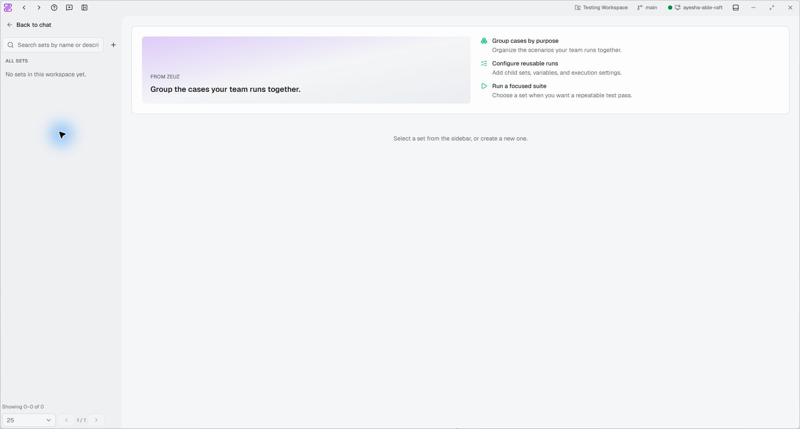
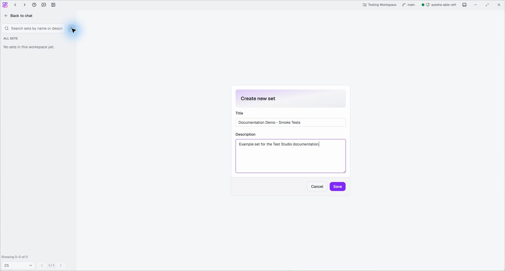
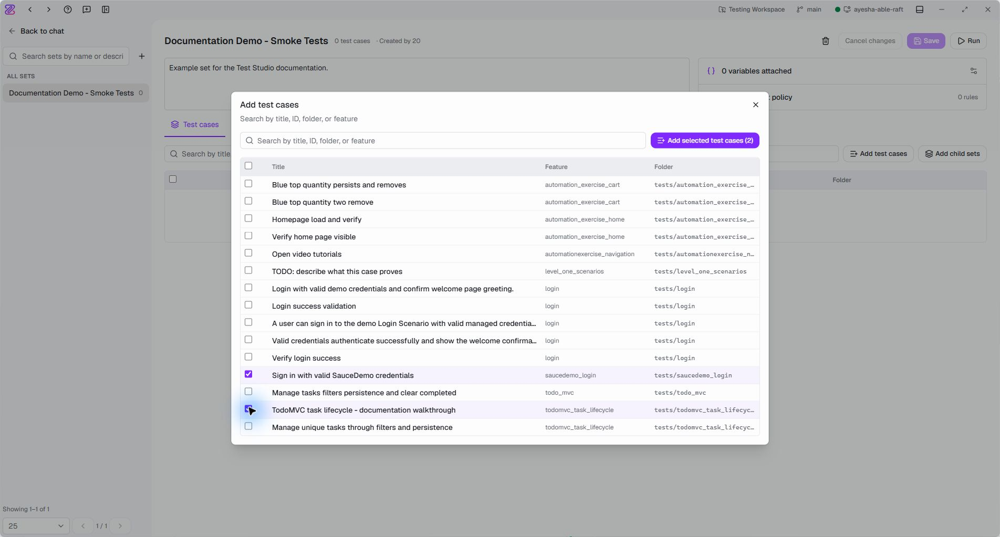
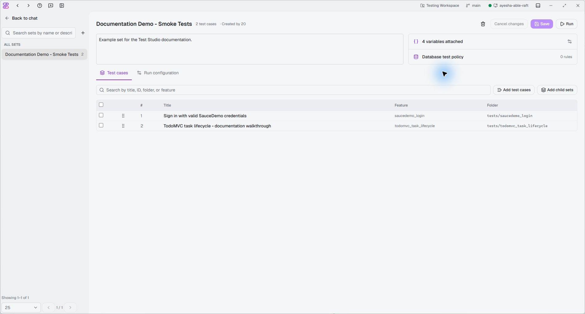
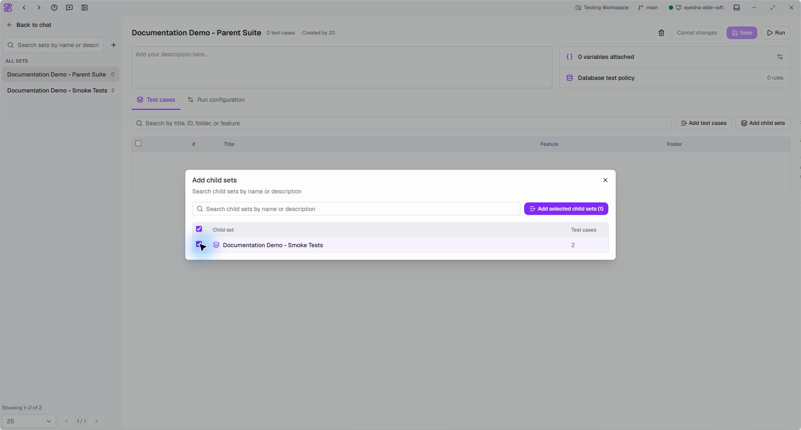
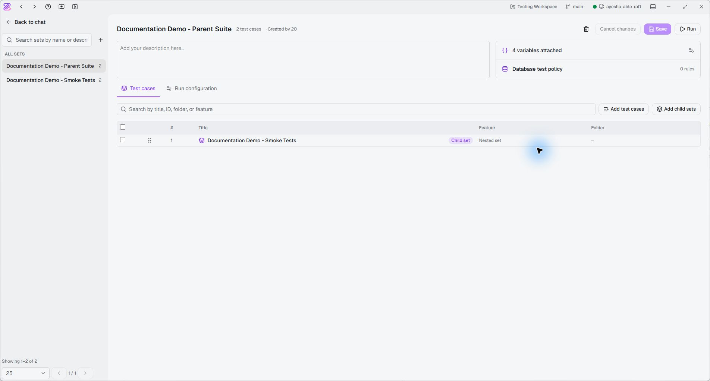
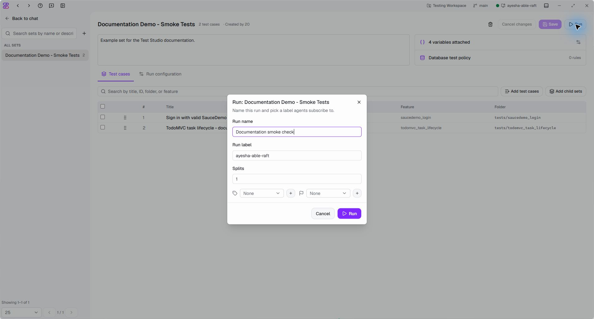
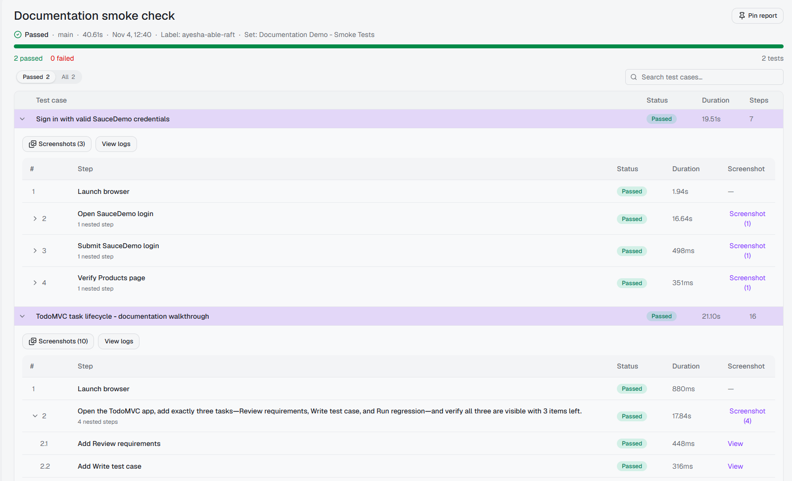

import MetaCard from '@site/src/components/MetaCard/';

A **set** is a named, ordered collection of existing test cases and optional child sets. Use a set to run the same group of checks together, such as a smoke suite after a deployment. Sets can also store choices for required variable values and a policy for database tests.

<MetaCard
difficulty="🟢 Easy"
lastUpdated="5 Nov, 2026"
/>

### Why it matters / Use Cases

- **Run a smoke suite** after deploying a change by grouping the checks you want to repeat.
- **Build a regression suite** by combining smaller sets for login, cart, and checkout.
- **Reuse a run target** in a scheduled or webhook-triggered [Automation](./Automations.md).

## Prerequisites

- Select the workspace that contains the tests you want to group. Confirm the branch used for execution and that the cases are available there.
- Make sure required variables, attachments, or other dependencies are available before running.
- For execution, use a runner or controller subscribed to the run label you choose.

## Features

### Find and Create a Set

1. Click **Sets** in the Test Studio sidebar.
2. Search **All sets** by name or description, or click an existing set to open it.
3. To create one, click **New set** (**+**) next to the search field.
4. Enter a unique **Title** and an optional **Description**. Click **Save** to open the set editor.

### Add and Organize Test Cases

1. On the **Test cases** tab, click **Add test cases**.
2. Search by title, ID, folder, or feature. Select the checkboxes beside the cases you want.
3. Click **Add selected test cases**. Close the picker when you finish adding cases, then check the set’s membership. If **Save** is enabled, click it to keep pending changes.
4. Use the drag handle to reorder rows. Selecting rows also exposes **Move selected to top**, **Move selected to bottom**, and **Remove selected**.
5. Review the order and save any pending changes before running.

The example below groups the SauceDemo sign-in check and the TodoMVC task lifecycle walkthrough. Each row references an existing test case. **Remove selected** removes the row from this set while keeping the underlying test case in the workspace.

### Add Child Sets

1. In **Sets**, open the set that will contain the others. On its **Test cases** tab, click **Add child sets**.
2. Search by name or description if needed, then select one or more existing sets from the same workspace. Click **Add selected child sets**. In this example, **Documentation Demo - Smoke Tests** is added to **Documentation Demo - Parent Suite**.

3. After **Set updated** appears, close the picker. The parent’s list shows a row labeled **Child set**. Use the drag handle to change its position if needed, then click **Save** for any pending edits.

When the parent runs, each child expands at its position in the list. If a test case appears through multiple paths, it is included once at its first position. The case count reflects the expanded membership, so it can differ from the number of rows in the editor. Test Studio blocks nesting that would create a cycle.

### Configure Variables and Database Tests

Open **Run configuration** to review the variables required by the member cases. Where a variable has multiple configured values, select the one this set should use. Review the **Effective value** and save pending changes. If a required variable is missing, add it in [Variables](./Variables.md) for the appropriate workspace and branch.

The **Database test policy** applies to cases that declare `requires = {"database"}`. Enable **Reset database after every database test** only when the intended test database and reset callbacks are ready. With the policy enabled, a missing or failed reset callback marks the case as errored.

### Run the Set and Review Results

1. Open the saved set and click **Run**.
2. Enter a **Run name** and a **Run label** that your intended runner subscribes to.
3. Choose **Splits**. Use `1` for a single split. Use additional splits when matching runners are available to pick up the extra work.
4. Select a **Version** or **Milestone** if you want to associate the run with a release.
5. Click **Run** in the dialog to submit the run. To view execution status and results from the Sets screen, click **Back to chat** at the upper left, then select **Run History** in the main left sidebar, below **Databases**. If the sidebar is collapsed, use **Toggle sidebar** in the top toolbar to expand it.

The screenshot shows a prepared run. The first **Run** button opens setup, and the button inside the dialog submits it. Reports retain the membership snapshot from the time of the run, so later edits to the set leave past results intact.

#### Review the Completed Run

From the Sets screen, click **Back to chat**, then select **Run History** in the main left sidebar, below **Databases**. Open the report with the run name you entered. The report header shows the overall status, branch, duration, run label, and set name. In the example below, **Documentation smoke check** finished with **2 passed** and **0 failed**.

1. Expand a test case to see its steps, statuses, and durations. Use **Screenshots (3)** for the SauceDemo case or **Screenshots (10)** for the TodoMVC case to open all captures for that case. Select **View logs** to inspect its execution logs.
2. In the **Screenshot** column, select a count such as **Screenshot (4)** to open the captures for that step. In the example, TodoMVC step 2 has four captures.
3. Expand a step using the arrow next to its number, then select **View** beside a nested action to open that action’s screenshot. A dash, as shown for **Launch browser**, means the run has no screenshot for that row.

### Rename or Delete a Set

Use **Edit set title** to rename it. Edit its description in the editor and save the change.

Use **Delete set** to remove a set you no longer need. If another set includes it as a child, remove that reference from each parent first. Existing runs keep their saved snapshots.

## Guidance for AI Agents

- Confirm the workspace, execution branch, and exact set before changing membership or running tests. Use an `@sets/` mention when available to identify the intended set in [New chat](<./New chat.md>).
- If the session exposes it, use `zeuz_core_sets_list` to resolve a set name or ID. Use `zeuz_core_test_cases_search` to find individual cases.
- Use `zeuz_core_sets_manage` for authorized changes. Prefer `add_members` or `remove_members` for incremental edits. Supplying `cases` and `childSets` in a create or update operation replaces the membership list. Confirm the target before deletion.
- Use `zeuz_core_executor_run_set` to run the saved set with its configuration. Confirm required values and the intended runner, and keep sensitive values out of prompts and reports.
- Report the set name, execution outcome, and report ID or link when available. Distinguish a submitted or queued run from a completed one.

Example request for a read-only review

> Find the Documentation Demo - Smoke Tests set in this workspace. List its cases in order and identify any missing required variables. Leave execution for a separate request.

## FAQs / Troubleshooting

Why is a test case missing from the picker?

Check the workspace and whether the case is available in the repository branch used by Sets. Clear the search and check whether the case is already in the set.

Why is the case count different from the number of rows?

A child set expands to its test cases. Repeated cases are counted once across the expanded membership.

Why is my set run still waiting?

Check the run label and whether a runner subscribed to it is online. If you requested multiple splits, check that runners are available to pick up the additional splits.

Why is a database test marked as errored after it ran?

If the set requires a reset after each database test, check that the case registered a reset callback and that the callback succeeded. Inspect the report before retrying.

