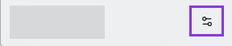
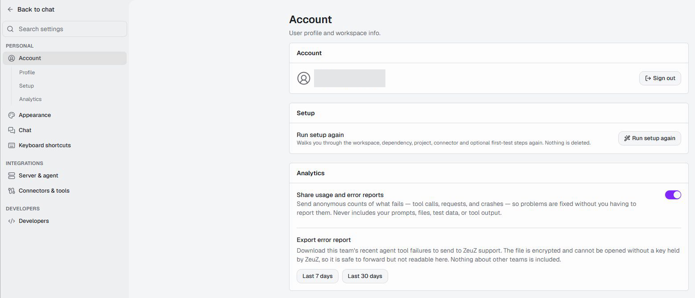
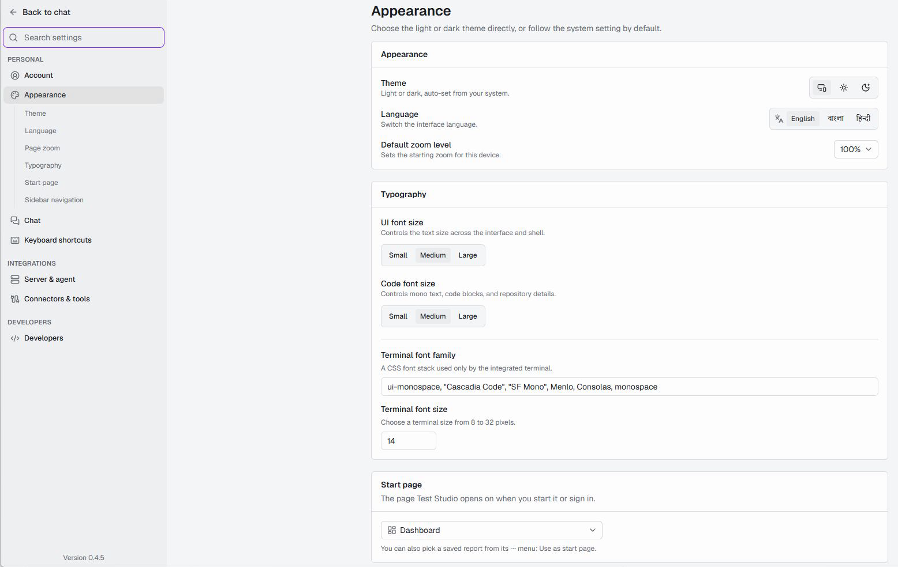
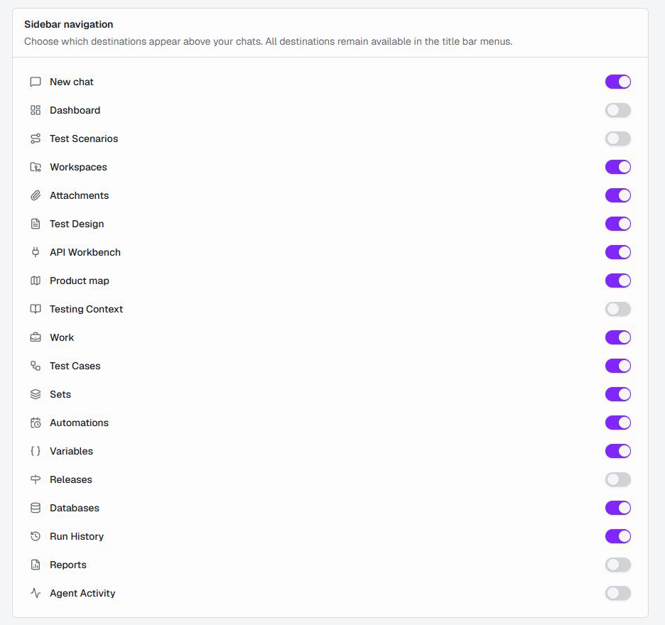
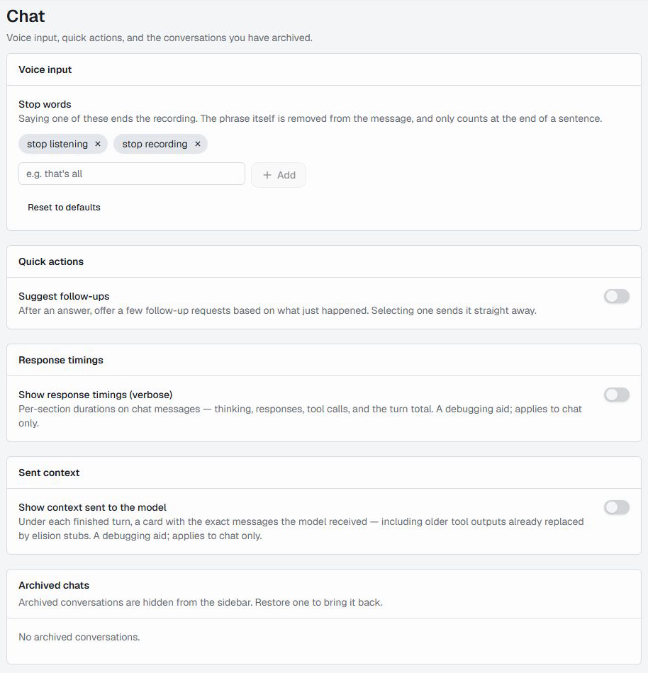
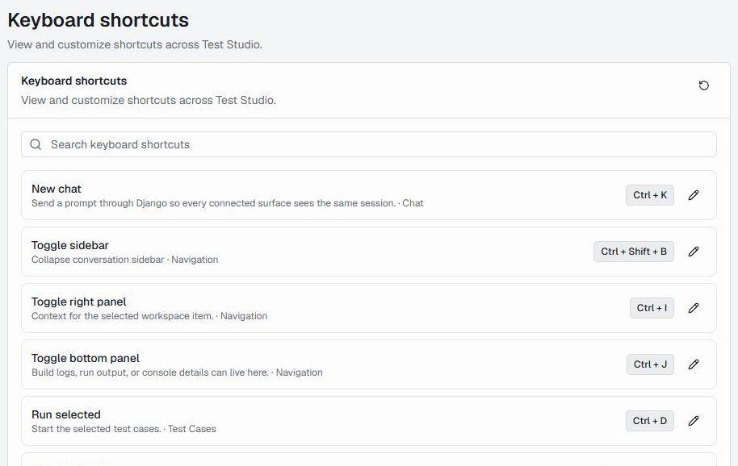
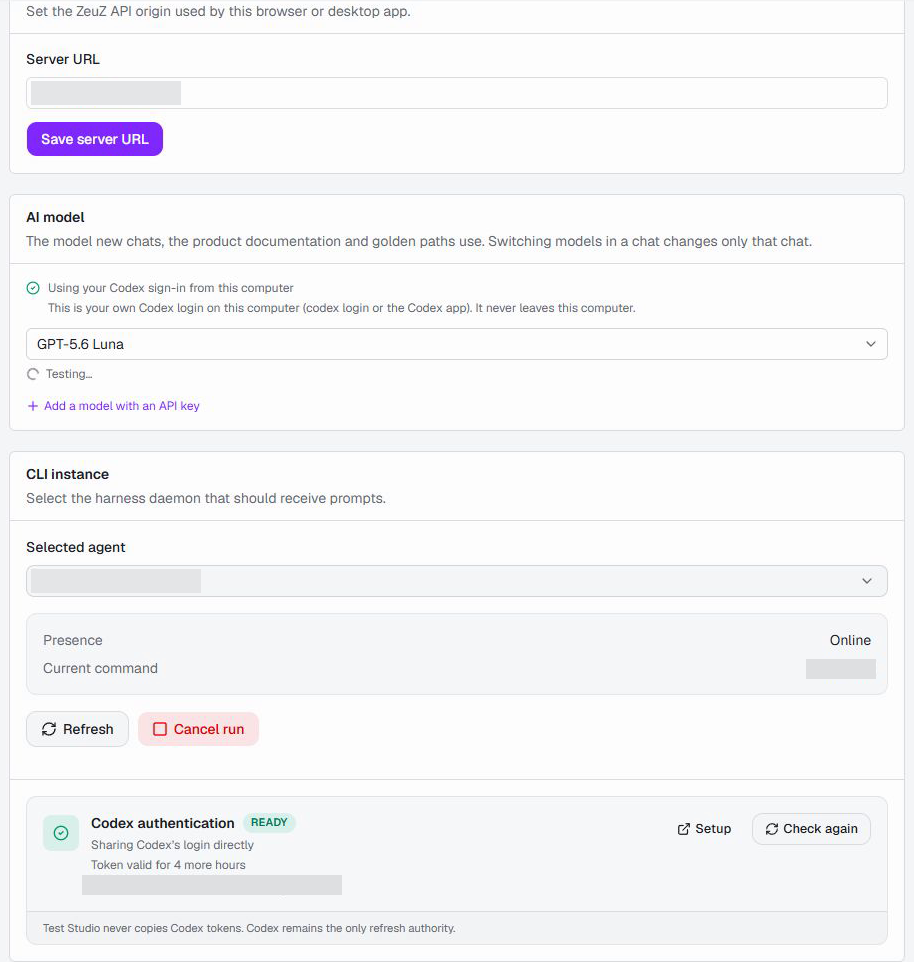
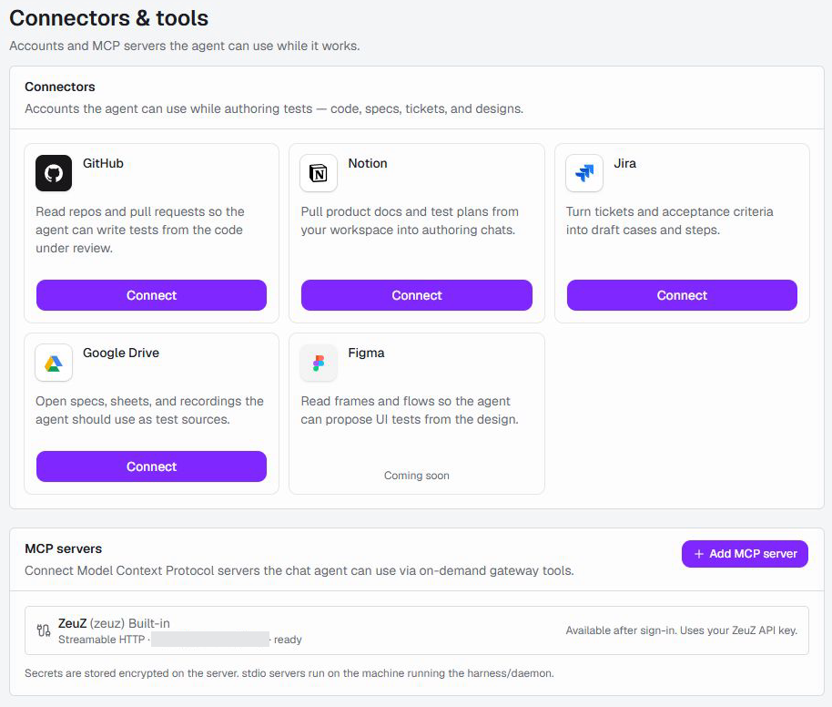
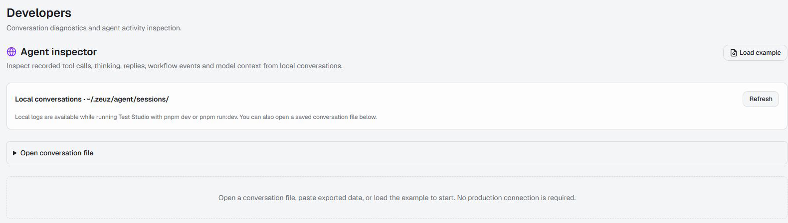

import MetaCard from '@site/src/components/MetaCard/';

**Test Studio Settings** is where you manage your account, personalize the interface and chat, and check which server, model, agent, and tools Test Studio uses.

<MetaCard
difficulty="🟢 Easy"
lastUpdated="17 Nov, 2026"
/>

## Why it matters / Use cases

- Open the Dashboard automatically by choosing it as your start page.
- Find a shortcut, restore an archived chat, or adjust the text size.
- Check the selected agent and its online status when a prompt is waiting.
- Review the connectors available to the agent when it authors tests.

## Prerequisites

- Open the Test Studio desktop app and sign in to see your account and connected workspace information.
- For connection setup, have the server URL or provider details supplied by your team. Verify the intended agent before changing which machine receives prompts.

## Open Settings

1. In the main Test Studio sidebar, look beside your name at the bottom left.
2. Click the sliders icon labeled **Test Studio settings**.
3. Select a section in the Settings sidebar or use **Search settings** to find a control by name. Click **Back to chat** to leave Settings.

For example, search for **Start page** to find the startup preference, or for **Selected agent** to find the machine that receives chat prompts.

## Account

- **Profile** shows the signed-in account and team information. **Sign out** ends the current session.
- **Setup → Run setup again** reopens onboarding so you can revisit workspace, dependencies, projects, connectors, and the optional first test.
- **Analytics** controls sharing anonymous usage and error counts. **Export error report** downloads an encrypted report of recent agent tool failures for the current team. Choose **Last 7 days** or **Last 30 days**.

To revisit a skipped setup step, open **Account → Setup** and click **Run setup again**. Use **Dependencies** in the setup flow to check tools such as Python 3 and the Playwright browser. If support asks for an error report, return to **Account → Analytics** and select the time window that includes the issue.

## Appearance

- **Theme** offers **System**, **Light**, and **Dark**. **Language** changes the interface language.
- **Page zoom** sets the starting zoom for this device. **Typography** lets you adjust UI and code text separately and set the integrated terminal font and size.
- **Start page** controls what opens at launch or sign-in. To start on the Dashboard, select **Dashboard** in the dropdown. A saved report can also become the start page using **Use as start page** in that report’s menu.
- **Sidebar navigation** controls which destinations appear above the chat list. Use the title bar menus to reach destinations you have hidden.

### Choose how Test Studio opens

1. Open **Appearance → Start page**.
2. Select **Dashboard** or another available destination. Test Studio uses this choice the next time it starts or you sign in.
3. To add a shortcut to the same destination, open **Appearance → Sidebar navigation** and enable it there. For example, enabling **Dashboard** adds it above the chat list.

Use **Page zoom** to change the overall scale. For text changes, use **UI font size** for interface text or **Code font size** for code blocks and repository details. The terminal has its own font family and size controls.

## Chat

- **Voice input** lets you add or remove stop words. Saying one at the end of a sentence ends the recording and removes the phrase from the dictated message.
- **Quick actions → Suggest follow-ups** offers suggested requests after an answer. Selecting one sends it immediately.
- **Response timings** shows how long individual parts of a chat turn took. **Sent context** shows the messages the model received for a finished turn.
- **Archived chats** lists archived conversations. Restore a conversation here to bring it back to the sidebar.

To add a stop phrase, open **Chat → Voice input**, enter the phrase, and click **Add**. Use the × beside an existing phrase to remove it, or **Reset to defaults** to restore the built-in list.

For a slow chat turn, use **Response timings** to see the time spent thinking, responding, and calling tools, along with the total. Use **Sent context** to inspect what the model received when investigating why it used particular information.

## Keyboard shortcuts

Search for an action in **Keyboard shortcuts** to see its current key combination. Click the pencil beside an action to change it. For example, search for **Toggle sidebar** to find the shortcut for showing and hiding the sidebar.

The description below each action shows where it applies. For example, **Run selected** applies in **Test Cases**, and **Toggle theme** is available across pages. Use the key combination currently displayed in your installation, since shortcuts can be customized.

## Server & agent

- **Server URL** is the ZeuZ API address used by this installation. Use **Save server URL** after entering the address supplied by your team.
- **AI model** chooses the default for new chats, product documentation, and golden paths. A model selected inside an existing chat applies to that chat. This panel also offers **Add a model with an API key**.
- **CLI instance → Selected agent** chooses which agent receives prompts. Check **Presence** and **Current command** to see whether the agent is online or busy. Click **Refresh** to update the list.
- **Codex authentication** shows readiness if the app uses the local Codex sign-in. Use **Check again** after completing the relevant sign-in setup.

### Check which part of the connection needs attention

1. Compare **Server URL** with the ZeuZ address supplied by your team. This determines which ZeuZ installation the app connects to.
2. Under **CLI instance**, click **Refresh**, then check the **Selected agent** and its **Presence**. An online agent can still have work in progress. Check **Current command** before using **Cancel run**, which stops the command on the selected agent.
3. Under **AI model**, check the model test result. A successful check shows **Works** and a response time. If the app uses the local Codex sign-in, check **Codex authentication** as well.

## Connectors & tools

**Connectors** lists accounts the agent can use while authoring tests. Use **Connect** beside an available service and follow its authorization flow. The app displays the availability of each connector on its card.

**MCP servers** lists the Model Context Protocol servers available to the chat agent. The built-in **ZeuZ** entry shows its status. Use **Add MCP server** to configure another server when your team supplies its connection details.

Pick the connector that holds the source you want the agent to use. For example, use **GitHub** for a pull request, **Jira** for a ticket and its acceptance criteria, or **Google Drive** for a specification. After connecting, name the source in your authoring prompt. For an MCP server that uses **stdio**, the configured command runs on the machine hosting the agent.

## Developers

**Agent inspector** displays events from recorded conversations, including tool calls, replies, and workflow events. Use **Load example** to explore the inspector or **Open conversation file** to inspect a saved record. The panel indicates when local conversation logs are available.

Start with **Load example** if you want to learn the inspector. For a specific issue, open the saved conversation file and follow the recorded tool calls and workflow events in order. If the inspector shows that local logs are unavailable in your setup, use a saved conversation file or exported data.

## Guidance for AI agents

Use the setting names visible in the app. When diagnosing a connection, report the selected agent’s **Presence**, the model check result, and any error message. Keep API keys and authentication details out of diagnostic summaries.

> Open Test Studio Settings and check Server & agent. Tell me whether the selected agent is online, whether the model check passed, and what I should check next if either reports a problem. Keep this review read-only.

## FAQs / Troubleshooting

How do I show Dashboard in the sidebar and at startup?

In **Appearance → Sidebar navigation**, enable **Dashboard** to show it in the sidebar. To open it at startup, select **Dashboard** under **Appearance → Start page**. These are separate controls.

Where do I change the charts displayed in the Dashboard?

Go to **Run → Dashboard → Customize**. Test Studio opens an editable report copy. Click **Save** to keep it. See the [Dashboard guide](./Dashboard.md).

What should I check if my agent is missing or offline?

Open **Server & agent → CLI instance**, check **Selected agent**, and click **Refresh**. If the intended agent still does not appear, check whether the agent is running on that machine and whether Test Studio is connected to the team’s expected server.

Why does an existing chat still show a different model?

The **AI model** setting under **Server & agent** sets the default for new chats. To change the model for an existing conversation, open that chat and use its model picker.

How do I bring an archived chat back?

Open **Settings → Chat → Archived chats**, find the conversation, and restore it. It will appear in the chat sidebar again.

