import MetaCard from '@site/src/components/MetaCard';

**ZeuZ Test Studio** is an AI-powered testing environment that integrates test case management, test automation, and test execution within a unified platform. It enables testers to progress from interpreting test requirements to creating, organizing, automating, and executing test cases through a structured workflow.

**Test Studio** uses AI to collect relevant context, analyze application behavior and testing requirements, organize test information, and scaffold automation. This enables testers to develop and prepare test cases more efficiently while maintaining a close relationship between each test case and its associated automation.

The platform also supports the execution of automated test cases and provides detailed execution information to help testers evaluate test outcomes. By combining AI-assisted capabilities with an end-to-end test case workflow, ZeuZ Test Studio offers a more efficient, consistent, and organized approach to software test management and automation.

<MetaCard
availableFrom="202605"
difficulty="🟢 Easy"
lastUpdated="30 Aug, 2026"
/>

### Why it matters / Use Cases:
- **AI-assisted test creation**: Helps interpret requirements and application context to create structured test cases.
- **Test automation**: Helps build automation from test cases, reducing the effort required to prepare automated tests.
- **Centralized test management**: Allows testers to create, organize, and maintain test cases together with their associated automation.
- **End-to-end test workflow**: Supports the process from understanding requirements and creating test cases to automating and executing them.
- **Test execution and validation**: Enables automated test execution and provides execution information for evaluating results.
- **Efficient and scalable testing**: Helps teams increase automation coverage while maintaining a consistent and organized testing workflow.

#### Integrations
- In Test Studio, **Integrations** means the settings used to connect Test Studio with external systems and supporting services. It includes the following options:  
  - **Server & Agents**: The **Server & Agents** section allows users to configure how Test Studio communicates with the ZeuZ server and which local agent is used to process commands. This section contains the following components:  
    - **Server URL**: The **Server URL** section allows users to specify the ZeuZ API server that the Test Studio browser or desktop application should communicate with.
      - **Server URL field**: Used to enter the URL of the required ZeuZ API server. For example, the field contains http://qa.zeuz.ai, indicating that the application is configured to communicate with a server running locally.
      - **Save server URL**: Saves the entered server URL and applies it to the application.
    - **CLI instance**: The **CLI Instance** section allows users to select the local agent that receives prompts from Test Studio. It contains the following options:  
      - **Selected agent**: Displays the currently selected agent.
      - **Presence**: Indicates the availability of the selected agent. The status **Online** means the agent is currently connected and available.
      - **Current command**: Displays the command currently being processed by the agent.
      - **Refresh**: Refreshes the agent status and retrieves the latest information.
      - **Cancel run**: Allows users to cancel an active run. It is disabled when there is no active run.
      - **Codex authentication**: The Codex authentication section displays the authentication status required for Codex. For example, 
        if the status is **“READY”**, it indicates that the authentication is currently available. The Codex Authentication section contains the following additional options:  
          **Setup**: Allows users to configure Codex authentication.
        - **Check again**: Checks the current authentication status again.
        - The screen also indicates how long the authentication token remains valid.

      :::note
      The note at the bottom clarifies that **Test Studio** does not copy **Codex** tokens and that Codex remains responsible for refreshing its authentication.

    

      :::
    
    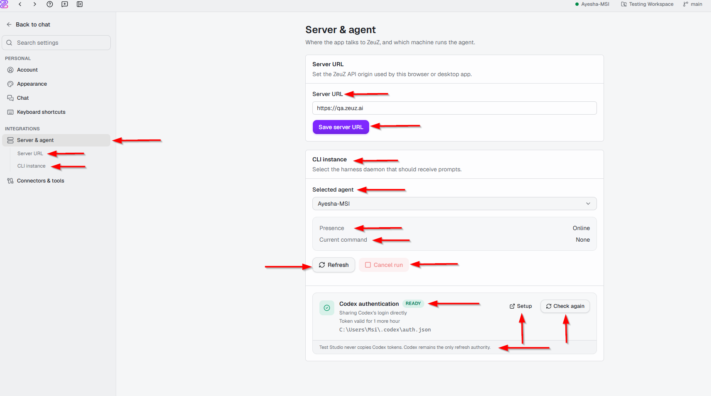
         
  - **Connectors & tools**: It refers to the integrations that allow Test Studio to connect with external services and use them as part of the testing workflow. It contains the following options:  
    **Connectors**: Connectors can provide Test Studio with additional project context and information from external services. For example,  
      - **GitHub**: Provides access to code repositories and development-related information.
      - **Notion**: Provides project documentation and knowledge.
      - **Jira**: Provides project issues, requirements, and task-related information.
      - **Google Drive**: Provides access to relevant documents and project resources.
      - **Figma**: Intended to provide design-related context;currently shown as **Coming Soon**.

  - **MCP servers**: It allows Test Studio’s chat agent to connect to external tools and services through on-demand gateway tools, enabling the agent to access additional capabilities when required. The following options are mentioned below:
    - **Add MCP server**: Connects another MCP-compatible server to Test Studio. Fill in the following field to add an MCP server:  
      - **Name**: A user-defined name for identifying the connection.
      - **Transport**: Selects how Test Studio communicates with the MCP server.
      - **URL**: The MCP server endpoint, shown as https://qa.zeuz.ai/mcp.
      - **Header key**: The authentication header sent with requests, such as X-API-KEY.
      - **Header value**: The corresponding secret or API key.
      - **Save server**: Saves the configuration and adds the server to Test Studio.
      - **Cancel**: Closes the dialog without saving.

    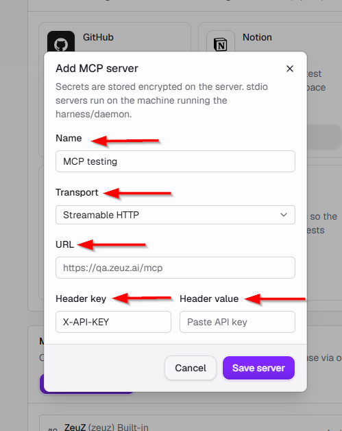
 
    - **ZeuZ (zeuz) Built-in**: The default ZeuZ MCP integration.
    - **Streamable HTTP**: The connection uses the HTTP-based MCP transport.
    - https://qa.zeuz.ai/mcp: The MCP server endpoint.
    - **Ready**: The server is configured and available.
    - **Available after sign-in**: Users must sign in before the agent can use this integration.
    - **Uses your ZeuZ API key**: Authentication is performed with the user’s ZeuZ API key.
    - **Security and local execution**: Saved credentials are encrypted on the server. MCP servers configured with the stdio transport run locally on the machine hosting the Test Studio harness or daemon.
 
    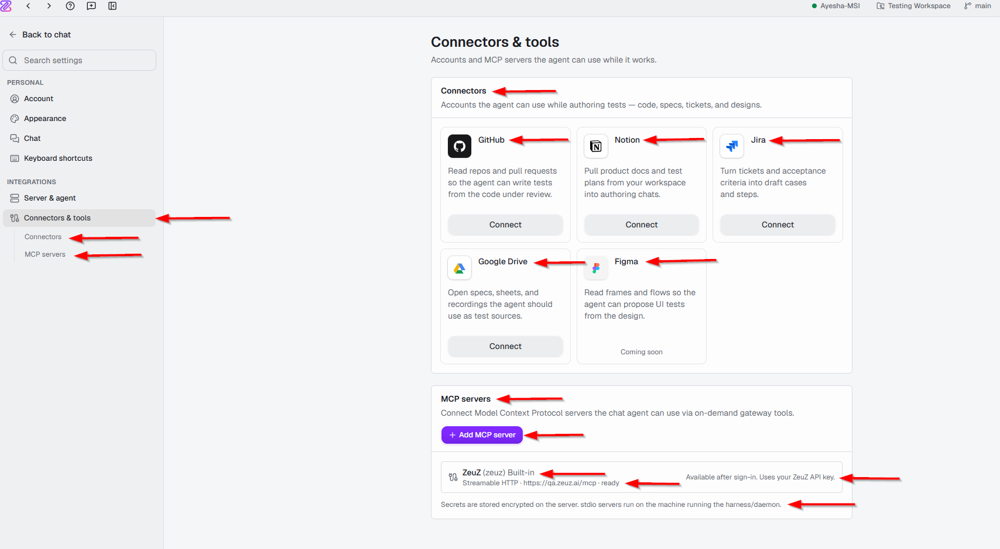

- The navigation area at the top of the Settings page displays two options:  
  - **Back to chat**: Takes users back to the main chat interface.
  - **Search settings**: Allows users to search for a specific setting or option instead of navigating through the settings menu manually.

    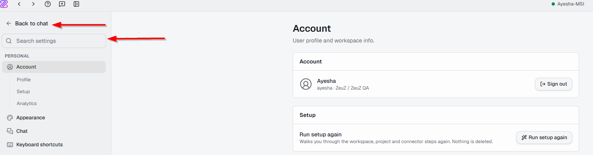
 

     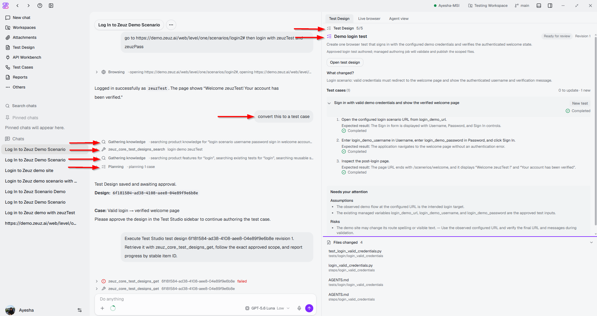

- Users can also attach files, and the Context Window section is available. 
- The **Context Window** section displays information about the model's context usage and token consumption for the current chat. It contains the following details:  
  - **Used**: Shows the amount of context currently used.
  - **Remaining**: Shows the remaining available context capacity.
  - **Window**: Shows the model's total context window capacity.
  - **Compacts at**: Indicates the token limit at which the conversation context may be compacted.
  - **Model**: Displays the model currently being used.
- The **Last turn** section provides token usage details for the most recent interaction:  
  - **Input**: Number of input tokens processed.
  - **Output**: Number of output tokens generated.
  - **Reasoning**: Tokens used for the model's reasoning.
  - **Cache read**: Tokens retrieved from the cache.
  - **Cache write**: Tokens written to the cache.
  - **Total tokens**: Total token usage for the last turn.
  - **Cost**: Estimated cost of the last turn.

  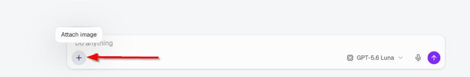

  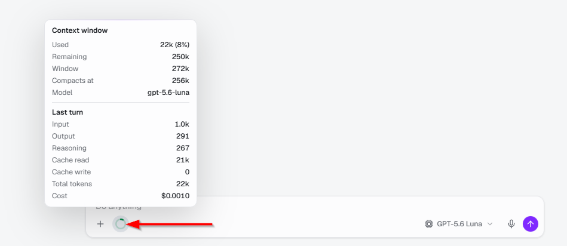

- The top navigation bar displays the currently selected machine and allows users to access or switch to a recently used workspace. 
- It also provides the **Toggle Bottom Panel** and **Toggle Right Panel** options.

       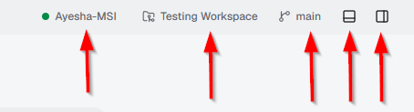

### Sidebar Options
- After clicking the Chat Options menu, three options are available:  
  - **Pin chat**: It allows users to pin a chat so that it remains easily accessible in the chat list.
  - **Rename chat**: It allows users to change the name of a chat.
  - **Archive chat**: It allows users to remove a chat from the active chat list without deleting it.

  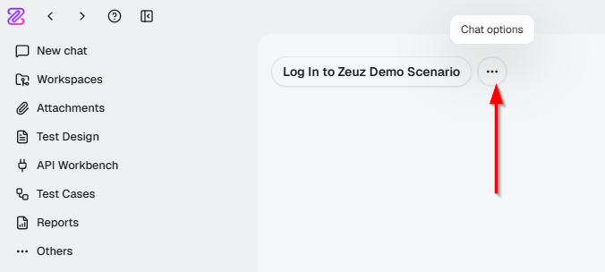

  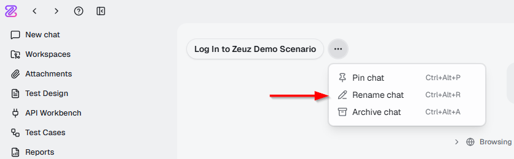

- The left-side panel displays the chat history under the **Chats** section. It also includes the **Search chats** option, which allows users to search for a specific chat. Additionally, the **Pinned chats** option provides access to chats that users have pinned for easier access.

   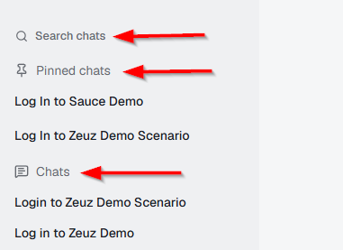

- There is another option called **Others** in the left-side panel. It is a navigation group that contains additional destinations that are not displayed directly in the main sidebar. It includes the following options:  
  - **Knowledge search**: Provides access to the knowledge search functionality.
  - **Work**: Provides access to work-related items and activities.
  - **Sets**: Provides access to test sets.
  - **Automations**: Provides access to automation-related items.
  - **Variables**: Provides access to variables used in testing.
  - **Databases**: Provides access to database-related resources.

  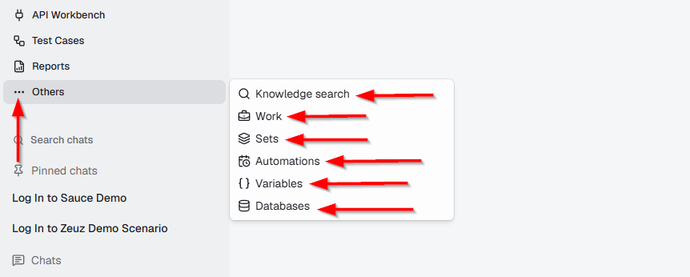
